# 프로젝트별 UI 화면과 테스트 내용

솔루션에 있는 각 프로젝트를 빌드해 실행한 **첫 화면**을 캡처하고, 코드를 읽어 **무엇을 시험하려고 만든 도구인지** 정리했습니다.

- 캡처 환경: Windows 11, Visual Studio 2022 MSBuild, `Debug` 빌드. 실행 직후의 화면이며 데이터는 넣지 않았습니다.
- 코드 위치는 `파일:줄` 형식으로 적었습니다.
- 캡처하면서 확인한 빌드·실행 문제는 맨 아래 [알려진 문제](#알려진-문제)에 모았습니다.

## 목차

| 분류 | 프로젝트 | 무엇을 시험하나 |
|---|---|---|
| 설비·통신 시뮬레이터 | [PlcSimulatorForm](#plcsimulatorform--가상-plc-서버) | 비전 SW ↔ PLC TCP 인터페이스(패킷 길이, 비트, 엔코더, 하트비트) |
| | [LightSimulator](#lightsimulator--조명-컨트롤러-rs-232-에뮬레이터) | 비전 SW의 조명 제어 명령(RS-232) |
| | [FileCopySimulator](#filecopysimulator--247-이미지-공급-시뮬레이터) | 공유 폴더 이미지 감시·처리의 장시간 안정성 |
| | [Simulator2](#simulator2--이미지-공급-시뮬레이터-hybrid) | 위 + 자정 폴더 전환, 멀티 카메라 동시 도착 |
| | [ToxicServer](#toxicserver--악성-mes-서버-콘솔) | MES 서버 무응답·단선 시 클라이언트 큐·스레드 동작 |
| | [ReproduceError5](#reproduceerror5--공유-폴더-error-32--error-5-재현기-콘솔) | 공유 폴더 파일 잠김·접근 거부 예외 처리 |
| 로그·통신 분석 | [CommLogProfiler](#commlogprofiler--plc-통신-로그-분석기) | 현장 통신 로그에서 단절·에러·NG·LOT 변경 추출 |
| | [PacketParserTool](#packetparsertool--plc-패킷-파서) | 로그 한 줄의 패킷을 항목별로 해석 |
| | [MemoryAnalyzer](#memoryanalyzer--다일-메모리-로그-그래프) | 여러 날 로그의 메모리·GDI·핸들 누수 추이 |
| | [MemoryTracker](#memorytracker--실시간-프로세스-리소스-모니터) | 실행 중 프로세스의 메모리·GDI·핸들 실시간 감시 |
| 이미지 비교 | [Comparator](#comparator--이미지-차이-검출기) | 기준/대상 이미지의 픽셀 차이 |
| | [OpenCvMaskComparator](#opencvmaskcomparator--문자-영역-마스킹-비교) | 기준 이미지 문자 영역을 대상 이미지에 투영 |
| 파일·데이터셋 유틸리티 | [DatasetExtractor](#datasetextractor--yolo-라벨-클래스-집계) | YOLO 라벨의 클래스 분포 |
| | [FileListExtractor](#filelistextractor--이미지-파일명-목록-추출) | 폴더의 이미지 파일명 목록 |
| | [FileRenamer](#filerenamer--일괄-복사이름-변경) | 시험용 파일 세트 만들기(복사 + 이름 치환) |
| | [XmlGenerator](#xmlgenerator--이미지-경로-xml-항목-생성) | 시뮬레이션용 이미지 경로 목록(XML `<string>`) |
| | [VisionTestToll](#visiontesttoll--빈-템플릿) | 빈 템플릿 |

---

## 설비·통신 시뮬레이터

### PlcSimulatorForm — 가상 PLC 서버

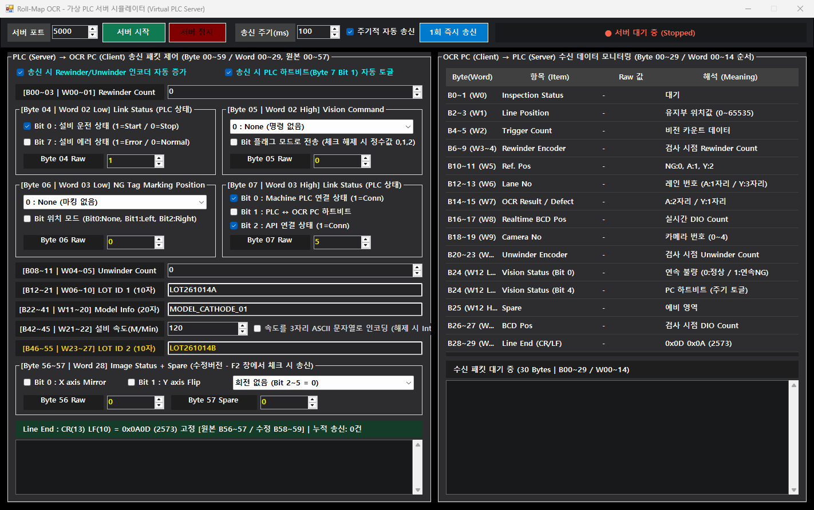

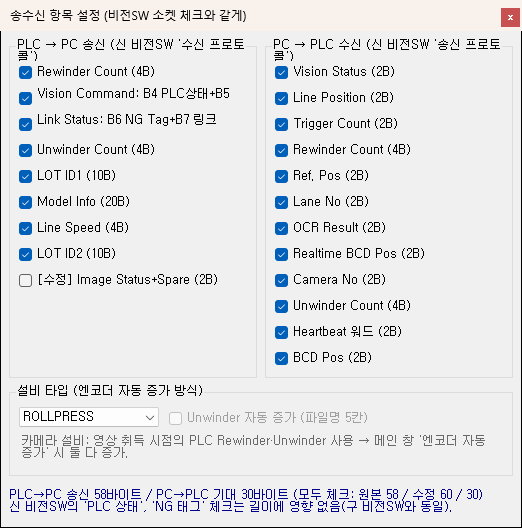

**테스트 목적**: 실제 PLC 없이 Roll-Map OCR 비전 SW의 PLC 소켓 통신을 시험합니다. 비전 SW는 클라이언트로 접속하고, 이 도구가 PLC(서버) 역할을 합니다.

**코드 분석**

- `TcpListener`로 포트(기본 5000)를 열고 접속을 받습니다 — `StartServer` [MainForm.cs:112](../PlcSimulatorForm/MainForm.cs:112).
- **PLC → PC 송신**: 체크된 항목만 순서대로 이어 붙이고 끝에 CR/LF를 붙이는 가변 길이 패킷을 만듭니다 — `BuildTxPacket` [MainForm.cs:1081](../PlcSimulatorForm/MainForm.cs:1081). 모든 항목을 쓰면 원본 맵 58바이트, `[수정] Image Status`를 켜면 60바이트입니다.
  - Rewinder/Unwinder 엔코더, Byte4 설비 상태(운전/에러), Byte5 Vision Command(Start/Stop), Byte6 NG Tag 위치, Byte7 링크 상태(Machine PLC·하트비트·API), LOT ID1/2, 모델, 속도(Int32 또는 3자리 ASCII), Image Status(X Mirror·Y Flip·회전).
  - 주기 송신(기본 100ms) 또는 1회 송신 — `PeriodicSendLoopAsync` [MainForm.cs:991](../PlcSimulatorForm/MainForm.cs:991), `SendSinglePacket` [MainForm.cs:1020](../PlcSimulatorForm/MainForm.cs:1020). 송신할 때마다 엔코더 자동 증가, 하트비트(Byte7 Bit1) 자동 토글을 켤 수 있습니다.
  - Raw 값 입력란으로 비트 조합을 직접 넣어 이상 패턴을 시험할 수 있습니다.
- **PC → PLC 수신**: TCP 스트림을 CR/LF 기준으로 끊어 30바이트 응답을 항목별로 해석해 오른쪽 표에 보여 주고, 수신 주기를 잽니다 — `ReceiveClientStreamAsync` [MainForm.cs:907](../PlcSimulatorForm/MainForm.cs:907), `ParseAndRenderRxPacket` [MainForm.cs:1165](../PlcSimulatorForm/MainForm.cs:1165). 길이가 설정과 다른 패킷은 비전 SW와 같은 규칙으로 버리고 실제 길이를 표시합니다.
- **F2 창**(시작 시 자동으로 열림, F2로 다시 열기): 비전 SW의 `수신/송신 프로토콜` 체크와 똑같이 항목을 맞추는 창입니다 — `ProtocolLayoutForm` [MainForm.cs:1499](../PlcSimulatorForm/MainForm.cs:1499). 설비 타입을 고르면 엔코더 증가 방식이 바뀝니다.
  - 카메라 설비(COATOR·ROLLPRESS·SLITTER·WINDER): Rewinder·Unwinder 둘 다 증가.
  - 공유 폴더 설비(NOTCHING·LAMI1·LAMI2): Rewinder는 파일명 값을 쓰므로 고정, Unwinder는 선택 시에만 증가.

**이 도구로 확인하는 것**: 패킷 길이 불일치 처리, Vision Command·설비 에러·링크 끊김에 대한 비전 SW 반응, 엔코더 연속 증가, PC 하트비트·검사 결과 응답이 맞게 오는지.

---

### LightSimulator — 조명 컨트롤러 RS-232 에뮬레이터

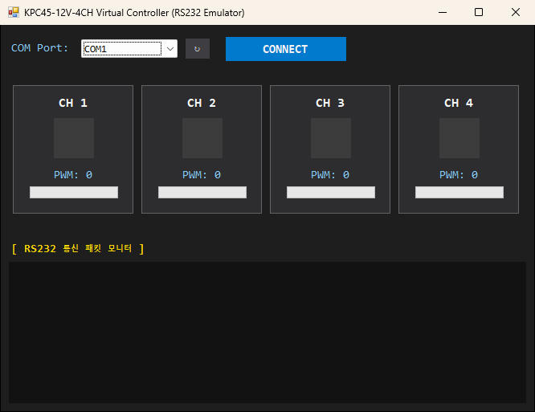

**테스트 목적**: KPC45-12V-4CH 조명 컨트롤러 없이 비전 SW의 조명 ON/OFF·밝기 명령이 맞게 나가는지 시험합니다. 가상 COM 포트 쌍(예: com0com)에 연결해 씁니다.

**코드 분석**

- 9600bps, 8N1로 포트를 엽니다 — `OpenPort` [Form1.cs:64](../LightSimulator/Form1.cs:64).
- 수신 바이트를 큐에 넣고 별도 루프에서 STX(0x02)~ETX(0x03) 프레임을 찾습니다 — `ParseLoopAsync` [Form1.cs:118](../LightSimulator/Form1.cs:118).
- 프레임 해석 — `ProcessPacket` [Form1.cs:153](../LightSimulator/Form1.cs:153):
  - 4바이트 `STX + CH + 'O'/'F' + ETX` → 채널 ON/OFF (`S`/`P`도 허용).
  - 8바이트 `STX + CH + 'W' + "0000" + ETX` → PWM 밝기(최대 1023으로 제한).
  - 채널 번호 오류, PWM 숫자 오류, 알 수 없는 길이는 로그에 경고로 남깁니다.
- 화면의 CH1~CH4 박스가 ON/OFF와 PWM 값을 보여 주고, 아래 모니터에 수신 패킷이 쌓입니다.

**이 도구로 확인하는 것**: 비전 SW가 보내는 채널 번호·명령 문자·PWM 자리수가 컨트롤러 규격과 맞는지.

---

### FileCopySimulator — 24/7 이미지 공급 시뮬레이터

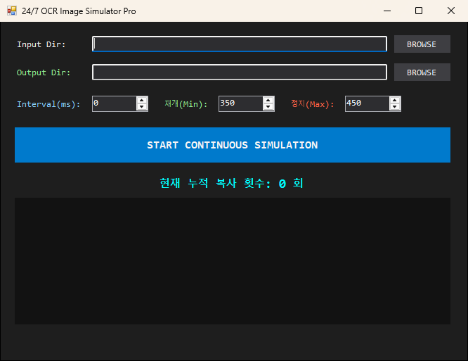

**테스트 목적**: 카메라가 공유 폴더에 이미지를 계속 떨어뜨리는 상황을 만들어, 비전 SW의 폴더 감시·처리를 장시간 시험합니다.

**코드 분석**

- 원본 폴더의 이미지(.bmp/.jpg/.jpeg/.png)를 시작할 때 한 번 읽어 파일명 템플릿으로 만듭니다 — `OptimizedFileTemplate` [Form1.cs:28](../FileCopySimulator/Form1.cs:28). 원본 이름 규격(`yyyyMMdd_HHmmssfff_…_camN`)은 유지하고 날짜·시간만 현재 시각으로 바꿉니다.
- 무한 루프로 `출력폴더\yyyyMMdd\`에 복사합니다 — `StartSimulationAsync` [Form1.cs:93](../FileCopySimulator/Form1.cs:93).
  - 날짜가 바뀌면 새 일일 폴더를 만들어 전환합니다(자정 롤오버).
  - **버퍼 제어(히스테리시스)**: 폴더의 파일 수가 `정지(Max)` 이상이면 멈추고, 비전 SW가 처리해 `재개(Min)` 이하로 줄면 다시 복사합니다. 파일 수는 `FileSystemWatcher`로 셉니다.
  - `Interval(ms)` = 0이면 최대 속도. 같은 밀리초에 이름이 겹치면 1ms 쉬고 다시 시도합니다.
  - 공유 위반(0x80070020) 등 I/O 예외는 로그에 남기고 계속 돕니다.

**이 도구로 확인하는 것**: 장시간 연속 입력에서 비전 SW의 처리 속도, 메모리·핸들 누수, 날짜 폴더 전환 처리.

---

### Simulator2 — 이미지 공급 시뮬레이터 (Hybrid)

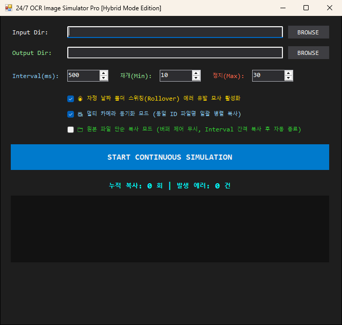

**테스트 목적**: FileCopySimulator에 장애 상황 재현 옵션을 더한 판입니다.

**코드 분석** — `StartSimulationAsync` [MainForm.cs:97](../Simulator2/MainForm.cs:97)

- **자정 폴더 전환 에러 모사**: 50회마다 대상 날짜를 오늘↔내일로 바꿔, 날짜 폴더가 계속 바뀌는 상황을 만듭니다.
- **멀티 카메라 동기화**: 파일명의 마지막 `_` 앞부분(예: `…_cam0`, `…_cam1`의 공통부)으로 묶어 같은 그룹을 한 번에 복사합니다 — `GetGroupKey` [MainForm.cs:245](../Simulator2/MainForm.cs:245). 여러 카메라 이미지가 동시에 도착하는 상황입니다.
- **단순 원본 복사 모드**: 버퍼 제어 없이 원본 이름 그대로 `Interval` 간격으로 한 바퀴 복사하고 자동 종료합니다 — [MainForm.cs:113](../Simulator2/MainForm.cs:113).
- 상태줄에 누적 복사 수와 에러 수를 함께 표시합니다.

**이 도구로 확인하는 것**: 날짜 폴더 전환 경계에서의 감시 누락, 여러 카메라 이미지의 짝 맞추기, 정해진 이미지 세트로 재현 시험.

---

### ToxicServer — 악성 MES 서버 (콘솔)

UI 없는 콘솔 프로그램입니다. 실행하면 아래와 같이 출력합니다(코드의 출력 문구 기준).

```text
==================================================
 [1호기 시뮬레이터] Toxic MES Server 기동 준비...
==================================================
[Listen] 포트 5000 대기 중... OCR 프로그램을 연결하세요.

[Connected] OCR 장비 연결됨! (x.x.x.x:port)
[Trap 1] 데이터를 읽지 않고 방치합니다. (TCP Window Exhaustion 시작...)
[Trap 2] 소켓을 강제로 끊었습니다! (OCR은 재연결 시도를 하며 큐가 잠길 것입니다)
[Trap 3] 5초간 연결을 거부합니다. (Connect Timeout 병목 유발 중...)
```

**테스트 목적**: MES 서버가 느리거나 응답하지 않을 때 OCR 프로그램의 송신 큐가 쌓여 메모리가 터지는(OOM) 현상을 재현합니다.

**코드 분석** — [Program.cs](../ToxicServer/Program.cs)

1. 접속은 받지만 `Receive`를 하지 않아 TCP 수신 창이 가득 차게 만듭니다 → 클라이언트 `Send`가 막힘 ([Program.cs:36](../ToxicServer/Program.cs:36)).
2. 10초 뒤 소켓을 강제로 끊습니다 ([Program.cs:46-48](../ToxicServer/Program.cs:46)).
3. 5초 동안 Accept를 하지 않아 클라이언트의 `Connect`가 타임아웃까지 기다리게 합니다 ([Program.cs:56](../ToxicServer/Program.cs:56)). 이 과정을 반복합니다.

**이 도구로 확인하는 것**: 송신 큐 상한, lock 안에서 Connect 대기로 비전 스레드가 멈추는지, 재연결 로직.

---

### ReproduceError5 — 공유 폴더 Error 32 / Error 5 재현기 (콘솔)

UI 없는 .NET 8 콘솔 프로그램입니다. 실행 출력(코드 기준):

```text
====================================================
[FA Network Simulator] Error 5 / Error 32 발생기
타겟 폴더: \\192.0.2.10\share\image\RollMap\20260928
====================================================
[1단계] 파일 생성 및 점유 중 (Error 32 유발 상태): 260928_..._000001_cam1.jpg
[2단계] 읽기 전용 속성 부여 완료 (Error 5 유발 상태): 260928_..._000001_cam1.jpg
```

**테스트 목적**: 비전 SW가 감시하는 공유 폴더에서 파일 접근 예외가 났을 때의 처리를 시험합니다.

**코드 분석** — [Program.cs](../ReproduceError5/Program.cs)

- 대상 폴더는 코드에 고정되어 있습니다([Program.cs:13](../ReproduceError5/Program.cs:13)). 사용 전에 바꿔야 합니다.
- 비전 SW 파일명 필터를 통과하는 이름(`…_cam1.jpg`)으로 파일을 만들고 `FileShare.None`으로 1초 독점합니다 → 비전 SW는 **Error 32(공유 위반)** ([Program.cs:35](../ReproduceError5/Program.cs:35)).
- 핸들을 닫자마자 읽기 전용으로 바꿉니다 → 이동·삭제 시 **Error 5(접근 거부)** ([Program.cs:49](../ReproduceError5/Program.cs:49)).
- 3초마다 반복합니다.

**이 도구로 확인하는 것**: 재시도·대기 로직, 읽기 전용 파일 처리, 예외 후 감시 루프가 살아 있는지.

---

## 로그·통신 분석

### CommLogProfiler — PLC 통신 로그 분석기

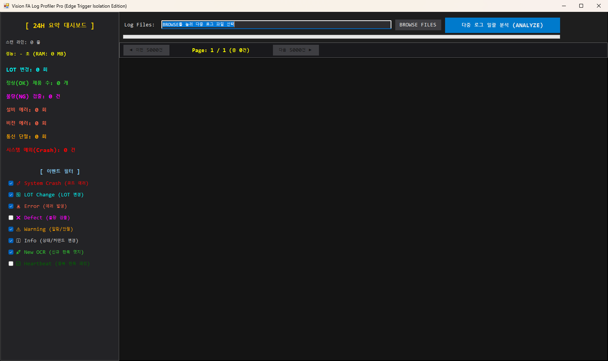

**테스트 목적**: 현장 PLC↔OCR PC 통신 로그 여러 개를 한 번에 읽어 장애·불량·LOT 변경 이력을 뽑습니다. 현장 문제 원인 분석용입니다.

**코드 분석** — `AnalyzeLogsAsync` [Form1.cs:72](../CommLogProfiler/Form1.cs:72)

- 로그 줄에서 `Received:` / `Send:` 뒤의 바이트를 파싱하고, 텍스트 메시지는 `Error`·`Exception`·`Disconnected`·`Closed`·`State:` 키워드로 분류합니다. `System.`으로 시작하거나 `Exception`이 든 줄은 시스템 예외(Crash)로 모읍니다.
- 수신 패킷: LOT ID1/2 변경, 설비 에러 발생/해제, Vision Command 변경, Machine PLC·API 링크 끊김, 카메라·공유 폴더 끊김을 이벤트로 만듭니다.
- 송신 패킷의 OCR 결과는 **엣지 트리거**로 구분합니다. 이전 결과와 다르면 신규 판독(`NewOcrResult`, [Form1.cs:318](../CommLogProfiler/Form1.cs:318)), 같으면 하트비트로 반복 전송되는 과거 값(`OcrOk`)입니다. 그래서 대시보드의 "정상 제품 수"는 실제 검사한 개수만 셉니다. 불량은 [Form1.cs:306](../CommLogProfiler/Form1.cs:306).
- 왼쪽 24H 요약 대시보드, 이벤트 필터 체크박스, 오른쪽 이벤트 표(5000건 단위 페이지, [Form1.cs:465](../CommLogProfiler/Form1.cs:465)).

**이 도구로 확인하는 것**: 특정 시간대의 통신 단절·에러 발생 순서, 실제 생산 수량, LOT 전환 시점.

---

### PacketParserTool — PLC 패킷 파서

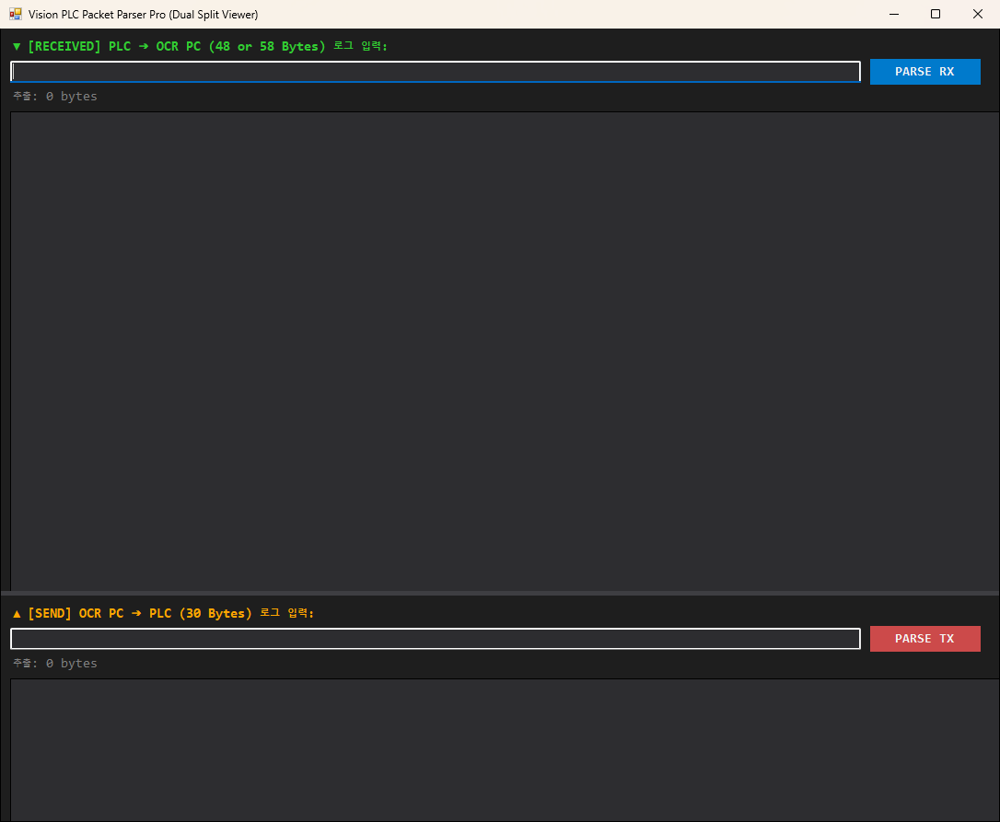

**테스트 목적**: 로그에 찍힌 송수신 패킷 한 줄을 붙여 넣어 바이트 단위로 해석합니다. PLC 측과 값을 맞춰 볼 때 씁니다.

**코드 분석**

- 문자열에서 숫자 바이트만 뽑습니다 — `ExtractBytesFromString` [Form1.cs:192](../PacketParserTool/Form1.cs:192).
- 위쪽(RX) **PLC → OCR 48/58B**: Rewinder, Link Status, Vision Command, NG Tag, Unwinder, LOT ID1, Model, Speed 등 — `ParsePlcToOcr` [Form1.cs:32](../PacketParserTool/Form1.cs:32).
- 아래쪽(TX) **OCR → PLC 30B**: Inspection Status, Line Position, Trigger Count, Rewinder, Ref Pos, Lane No, OCR Result, BCD Pos, Camera No 등 — `ParseOcrToPlc` [Form1.cs:105](../PacketParserTool/Form1.cs:105).
- 결과는 `바이트 / 항목 / 해석값 / Raw` 표로 보여 줍니다.

**이 도구로 확인하는 것**: 특정 패킷의 항목 값이 인터페이스 맵대로 들어갔는지.

---

### MemoryAnalyzer — 다일 메모리 로그 그래프

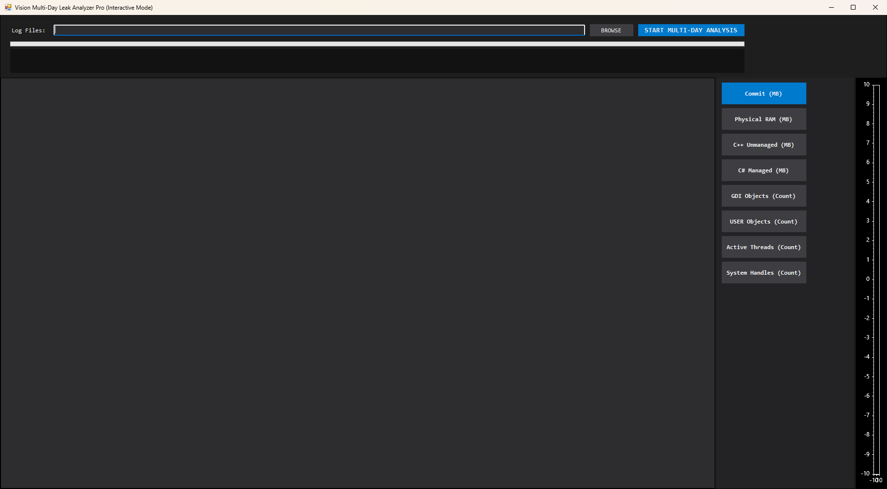

**테스트 목적**: 비전 SW를 며칠 돌린 로그로 메모리·리소스 누수를 찾습니다.

**코드 분석**

- 여러 로그 파일을 파일명의 날짜(`yyyy-MM-dd` 또는 `yyyyMMdd`) 순으로 이어 읽고, `[Mem]`과 `[Res]`가 함께 있는 줄만 파싱합니다 — `ParseLogsAsync` [MainForm.cs:64](../MemoryAnalyzer/MainForm.cs:64), [MainForm.cs:101](../MemoryAnalyzer/MainForm.cs:101).
- 추출 항목: `Commit`, `RAM`, `C#`, `C++`(MB), `GDI`, `User`, `Thread`, `Handle`. 한 파일 안에서 시간이 되돌아가면 자정이 지난 것으로 보고 날짜를 하루 더합니다.
- 오른쪽 버튼으로 지표를 고르면 ScottPlot `SignalXY`로 그래프를 그리고, 마우스 위치의 시간·값을 표시합니다 — `RenderSingleMetricChart` [MainForm.cs:284](../MemoryAnalyzer/MainForm.cs:284).

**이 도구로 확인하는 것**: Commit·C++ 비관리 메모리·GDI·핸들이 시간에 따라 계속 늘어나는지(누수), 특정 시점의 급증.

---

### MemoryTracker — 실시간 프로세스 리소스 모니터

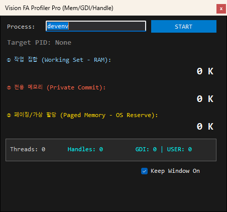

**테스트 목적**: 실행 중인 비전 SW 프로세스를 1초마다 감시해 메모리·GDI·핸들 증가를 바로 봅니다.

**코드 분석**

- 프로세스 이름(기본 `devenv`)으로 찾고, 여러 개면 Working Set이 가장 큰 것을 고릅니다 — `GetProcessMemory` [MainForm.cs:67](../MemoryTracker/MainForm.cs:67).
- Working Set, Private Commit, Paged Memory, 스레드, 핸들, `GetGuiResources`로 GDI/USER 객체 수를 읽습니다. 타이머 주기 1초([MainForm.cs:151](../MemoryTracker/MainForm.cs:151)).
- GDI > 8000 또는 핸들 > 50000이면 빨간색으로 경고합니다(GDI 기본 한도 10000) — [MainForm.cs:214](../MemoryTracker/MainForm.cs:214).
- 항상 위 창(TopMost)으로 떠 있어 다른 창 위에서 볼 수 있습니다.

**이 도구로 확인하는 것**: 특정 동작(검사, 화면 전환 등)을 반복할 때 GDI·핸들·메모리가 돌아오지 않고 쌓이는지.

---

## 이미지 비교

### Comparator — 이미지 차이 검출기

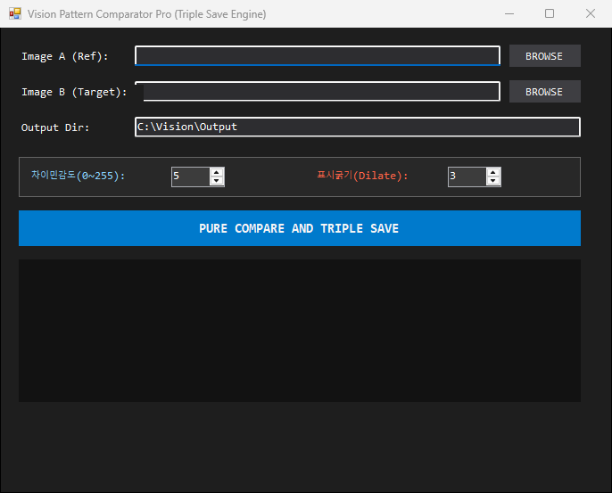

**테스트 목적**: 기준 이미지 A와 대상 이미지 B를 비교해 다른 부분을 표시합니다. 검사 결과나 알고리즘 변경 전후 비교에 씁니다.

**코드 분석** — `OpenCvDeltaComparator` [MainForm.cs:30](../Comparator/MainForm.cs:30)

- 두 이미지를 흑백으로 읽어 해상도가 다르면 중단합니다.
- `Absdiff` → `차이민감도`로 이진화 → `표시굵기`만큼 팽창(Dilate) — [MainForm.cs:69](../Comparator/MainForm.cs:69).
- 3종 저장: `_RedHighlight`(B 위에 차이 부분 빨간색), `_DefectBlackMask`(정상 흰색/차이 검은색), `_DefectCovered`(B에서 차이 부분을 검게 도려냄).
- 시작할 때 64비트 프로세스인지, `dll\x64\OpenCvSharpExtern.dll`이 로드되는지 검사합니다 — `VisionEnvironmentValidator` [MainForm.cs:296](../Comparator/MainForm.cs:296).

> 솔루션 기본 구성(`Debug|Any CPU`)으로 빌드해 실행하면 32비트로 떠서 아래 오류가 먼저 뜹니다. 위 화면은 `x64` 플랫폼으로 빌드해 캡처했습니다. [알려진 문제](#알려진-문제) 참고.
>
> 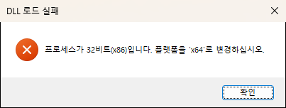

---

### OpenCvMaskComparator — 문자 영역 마스킹 비교

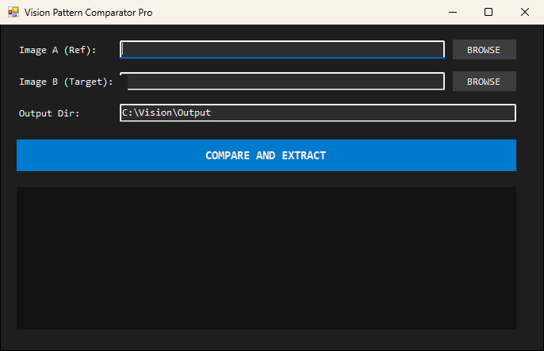

**테스트 목적**: 기준 이미지의 문자(인쇄) 영역만 대상 이미지에서 잘라 봅니다. 같은 위치의 문자가 대상 이미지에서 어떻게 찍혔는지 확인합니다.

**코드 분석** — `CompareAndSaveAsync` [MainForm.cs:26](../OpenCvMaskComparator/MainForm.cs:26)

- 기준 이미지 A를 Otsu 반전 이진화해 어두운 문자 부분을 마스크로 만듭니다 — [MainForm.cs:60](../OpenCvMaskComparator/MainForm.cs:60).
- 흰 배경에 대상 이미지 B를 마스크 부분만 복사해 `<이름>_Filtered.<확장자>`로 저장합니다.
- 해상도가 다르면 중단하고, OpenCV 네이티브 DLL이 없으면 해결 방법을 로그에 보여 줍니다.

---

## 파일·데이터셋 유틸리티

### DatasetExtractor — YOLO 라벨 클래스 집계

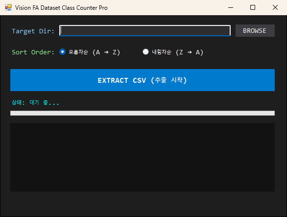

**용도**: 학습 데이터셋의 클래스 분포를 확인합니다.

**코드 분석** — `ExtractDatasetCsvAsync` [Form1.cs:64](../DatasetExtractor/Form1.cs:64)

- 선택 폴더(하위 폴더 제외)의 `*.txt` 라벨 파일을 읽어 각 줄 첫 숫자(클래스 ID)를 셉니다 — `ParseLabelFile` [Form1.cs:233](../DatasetExtractor/Form1.cs:233).
- `파일명,전체개수,클래스_0,클래스_1,…` 형식의 CSV(UTF-8 BOM)를 임시 파일에 쓴 뒤 `File.Move`로 바꿔 넣습니다. 파일명 정렬은 오름/내림차순 선택.

---

### FileListExtractor — 이미지 파일명 목록 추출

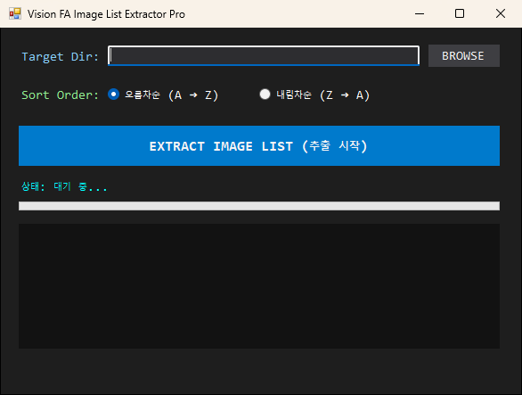

**용도**: 폴더의 이미지 파일명 목록을 TXT로 뽑습니다.

**코드 분석** — `ExtractImageListAsync` [MainForm.cs:61](../FileListExtractor/MainForm.cs:61)

- 대상 확장자: .jpg .jpeg .bmp .png .tif .tiff ([MainForm.cs:56](../FileListExtractor/MainForm.cs:56)).
- 파일명만 모아 정렬하고, 임시 파일에 쓴 뒤 `File.Move`로 저장합니다([MainForm.cs:131](../FileListExtractor/MainForm.cs:131)).

---

### FileRenamer — 일괄 복사·이름 변경

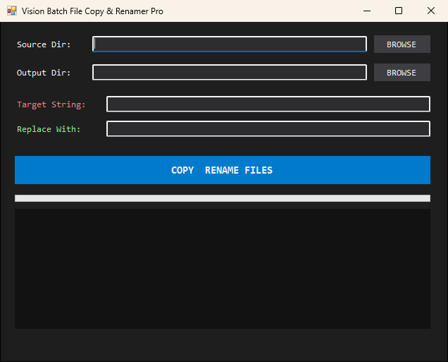

**용도**: 시험용 이미지 세트를 만들 때, 이름에 특정 문자열이 든 파일만 골라 다른 문자열로 바꿔 Output 폴더에 복사합니다(원본은 그대로).

**코드 분석** — `FileRenamerCore.ProcessAsync` [Form1.cs:16](../FileRenamer/Form1.cs:16)

- `Target String`이 이름에 든 파일만 고르고, 이름을 `Replace With`로 치환해 `File.Copy`(덮어쓰기 허용)합니다. 하위 폴더는 보지 않습니다.

---

### XmlGenerator — 이미지 경로 XML 항목 생성

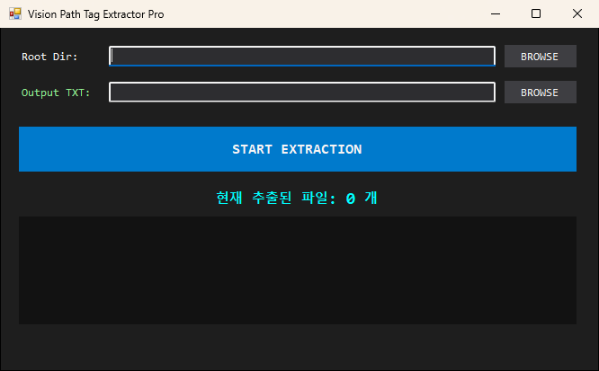

**용도**: 시뮬레이션 설정에 넣을 이미지 경로 목록을 만듭니다.

**코드 분석** — `ImageTagExtractorCore.ProcessAsync` [Form1.cs:33](../XmlGenerator/Form1.cs:33)

- 루트 폴더를 재귀로 돌며 .bmp .jpg .jpeg .png .tif .tiff 파일의 **전체 경로**를 `    <string>경로</string>` 한 줄씩 씁니다(기본 출력: 바탕화면 `Simulation_ImageList.txt`).
- 권한이 없는 폴더는 건너뛰고, 실행 중 STOP으로 취소할 수 있습니다.

---

### VisionTestToll — 빈 템플릿

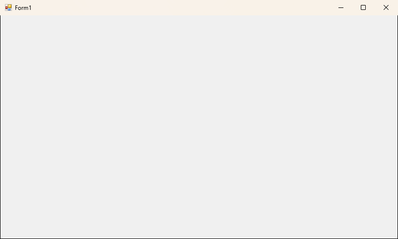

기능이 없는 기본 WinForms 템플릿입니다. 솔루션 파일에는 포함되어 있지 않습니다.

---

## 알려진 문제

캡처하면서 확인한 내용입니다. 이번 작업에서는 코드를 고치지 않았습니다.

| 프로젝트 | 증상 | 원인 |
|---|---|---|
| Comparator, MemoryTracker | 솔루션 빌드 시 `CS0260` 오류(빌드 실패) | `MainForm.cs`의 `public class MainForm`에 `partial`이 없는데 `MainForm.Designer.cs`는 `partial class MainForm`으로 선언됨. 캡처는 복사본에 `partial`을 붙여 빌드했습니다. |
| OpenCvMaskComparator | 솔루션에 없음 | `.sln`에 등록되어 있지 않음(단독 빌드는 정상). |
| VisionTestToll | 솔루션에 없음 | `.sln`에 등록되어 있지 않음(단독 빌드는 정상). |
| Comparator | `Debug|Any CPU`로 실행하면 "프로세스가 32비트(x86)입니다" 오류 | `Any CPU` 구성은 32비트 우선으로 실행되고, 코드가 64비트만 허용함. `x64` 플랫폼으로 빌드하면 정상. |
